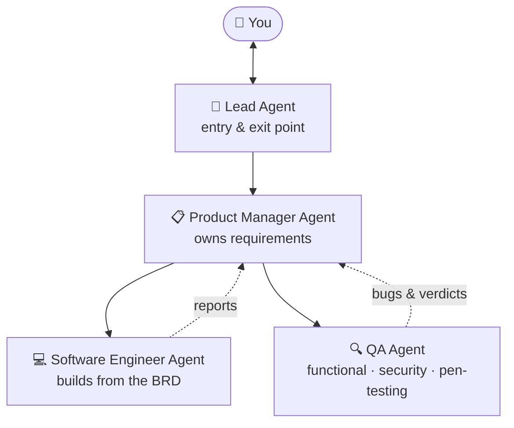

<h1 align="center">
  
</h1>

<p align="center">
  <i>Building backends that don't flinch, and agents that don't wander.</i><br>
  📍 Ghana 🇬🇭 &nbsp;|&nbsp; 🎓 BSc Computer Engineering, KNUST (First Class)
</p>

---

## 🧠 `whoami`

```bash
$ whoami
daniel_dzotsi

$ cat /etc/role
backend_engineer && system_architect && agentic_workflow_builder

$ echo $MISSION
"Make money-moving systems reliable, and make repetitive work disappear."
```

---

## 🤖 Agentic Workflow Lab

I design systems where AI agents share the load like a real engineering team.



**What I work with**
- 🕸️ **LangGraph** for stateful multi-agent orchestration (Lead → PM → SWE/QA hierarchy, currently in design)
- ⚙️ **n8n** for automation pipelines (for example, email → S3 ingestion with Gmail and boto3)
- 🔌 Tool-calling, hand-offs between agents, and human-in-the-loop checkpoints
- 🧪 Treating QA as a first-class agent: if an agent builds it, another agent tries to break it

---

## 🔬 Currently in the lab

- 📒 **Double-entry ledger API in Go (Gin)**: integer minor-unit money, multi-currency FX, async transfers with holds and reversals, testcontainers, CI
- 🛣️ **RoadWatch GH**: crowdsourced road-hazard reporting for Ghanaian roads
- 🏦 **Loan platform design**: borrower onboarding and repayment, end to end
- 🕸️ **Multi-agent orchestration** with LangGraph

---

## 🛠️ Tech arsenal

**Languages** &nbsp;


**Backend** &nbsp;


**Data** &nbsp;


**AI & Automation** &nbsp;


**Infra** &nbsp;


---

## 🧭 How I think about systems

- 🧾 **Money is integers, never floats.** Ledgers are append-only and balances are derived.
- 🔁 **Everything async must be retryable and idempotent.** Jobs fail, so design for it.
- 📐 **Write the PRD and ADRs before the code.** Decisions are cheaper on paper.
- 🤝 **Agents are teammates, not magic.** Give them roles, boundaries, and a reviewer.

---

## 📬 Let's connect

Open to backend and AI-automation roles, and to interesting freelance builds.

[](https://linkedin.com/in/daniel-dzotsi)
[](mailto:danieldzotsi14@gmail.com)

<p align="center"><sub>⚡ Fun fact: I'd rather automate a task once than do it twice.</sub></p>
